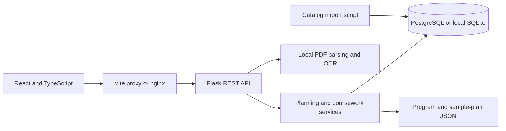

<p align="center"></p>

<h1 align="center">Gopher Planner</h1>

<p align="center">Turn coursework into a degree plan you can understand, edit, and build on.</p>

<p align="center">
  <a href="LICENSE"></a>
  
  
  
</p>

<p align="center">
  <a href="#quick-start">Quick start</a> ·
  <a href="docs/PROJECT.md">Project guide</a> ·
  <a href="docs/ARCHITECTURE.md">Architecture</a> ·
  <a href="CONTRIBUTING.md">Contribute</a> ·
  <a href="docs/ROADMAP.md">Roadmap</a> ·
  <a href="https://github.com/Troppy2/Gopher-Planner/issues">Issues</a>
</p>

Gopher Planner helps University of Minnesota students and academic advisors build personalized multi-semester course plans. It combines completed and current coursework, versioned degree requirements, prerequisites, preferred credit load, and graduation goals.

Import an APAS/transcript PDF or enter courses manually, see your progress, and adjust your plan in semester and prerequisite-graph views.

**Active development:** compare generated plans with your official APAS audit and advisor guidance. A suggested schedule is not registration, a seat guarantee, or certification that every degree requirement is satisfied.

## Contents

- [Features](#features)
- [Quick start](#quick-start)
- [Configuration](#configuration)
- [Database and data](#database-and-data)
- [Development checks](#development-checks)
- [Architecture](#architecture)
- [Roadmap](#roadmap)
- [Contributing](#contributing)
- [Documentation](#documentation)
- [License and credits](#license-and-credits)

## Features

| Area | Current behavior |
| --- | --- |
| Authentication | Google sign-in for verified `@umn.edu` accounts, with server-side cookie sessions. |
| Coursework | PDF import with local OCR fallback, manual entry, and later edits to status, term, grade, and credits. |
| Dashboard | GPA, credit progress, current/future classes, and completed versus projected requirement progress. |
| Planning | Sample-plan seeding, prerequisite ordering, offering-season checks, credit limits, and requirement-aware suggestions. |
| Editing | Move/add/remove current and future classes, edit current credits, and swap labeled gen-ed suggestions. Ordinary edits autosave; generated plans wait for confirmation. |
| Catalog | Search, filters, pagination, course details, prerequisites, and add-to-plan actions. |
| Profile | Major, standing, career goal, credit preference, and graduation target. Major changes require catalog-year confirmation again. |
| Interface | Responsive semester/graph views, keyboard controls, course drawers, layout-matched skeletons, and explicit empty/error states. |

Professor history, embedded grade distributions, scheduled section updates, and registration export are future work. Links in a course drawer do not mean those integrations are implemented.

## Quick start

### Prerequisites

- Python **3.12+** and [uv](https://docs.astral.sh/uv/).
- Node.js **22.12+** and npm. The installed Vite version also supports Node 20.19+; the frontend container uses Node 22.
- Git and a Google OAuth web client ID for interactive sign-in.
- Docker only if using the container setup.

### 1. Clone and configure

```powershell
git clone https://github.com/Troppy2/Gopher-Planner.git
cd Gopher-Planner
Copy-Item backend/.env.example backend/.env
Copy-Item frontend/.env.example frontend/.env
```

Edit the copied files locally. Use the same Google client ID in both, set a random `JWT_SECRET`, and set `FRONTEND_ORIGIN=http://localhost:5173` in the backend file.

For local SQLite development, replace the sample Supabase URL in `backend/.env` with:

```dotenv
DATABASE_URL=
FLASK_ENVIRONMENT=development
COOKIE_SECURE=false
```

An empty development URL selects `backend/instance/dev.db`. Process environment variables take precedence over files. Check the intended destination before any migration or import. Never commit `.env` files.

### 2. Start the backend

```powershell
cd backend
uv sync
uv run flask --app app db upgrade
uv run python scripts/import_catalog.py --csv data/catalog-exports/courses.2026-11-23.csv
uv run flask --app app run --debug --port 5000
```

The import writes catalog tables in your selected local database. It does not modify the bundled source database. API prefix: `/api/v1`. Health: `http://localhost:5000/health`.

### 3. Start the frontend in another terminal

From the repository root:

```powershell
cd frontend
npm ci
npm run dev -- --port 5173 --strictPort
```

Open **http://localhost:5173**. Vite proxies `/api` to port 5000. Leave `VITE_API_URL` unset. Add the same localhost origin to your Google OAuth client's authorized JavaScript origins before signing in.

### Docker alternative

Copy root `.env.example` to `.env`, fill in local PostgreSQL credentials and Google client IDs, and use `FRONTEND_ORIGIN=http://localhost:3000`.

```powershell
docker compose up --build
```

Open **http://localhost:3000**. Compose runs PostgreSQL 17, Flask, and an nginx-served frontend. Load catalog data into this local stack with:

```powershell
docker compose exec api uv run python scripts/import_catalog.py --csv data/catalog-exports/courses.2026-11-23.csv
```

Stop while preserving database storage:

```powershell
docker compose down
```

With `FLASK_ENVIRONMENT=development` (the Compose default), the API container applies migrations on start and runs Flask's development server. With `FLASK_ENVIRONMENT=production` it runs gunicorn instead; set `RUN_MIGRATIONS=false` there and let CD migrate. `GET /health` reports that the process is up; `GET /ready` also checks the database and is the one to use for deploy health checks.

## Configuration

| Variable | Purpose |
| --- | --- |
| `GOOGLE_CLIENT_ID` | Required backend Google OAuth audience. |
| `JWT_SECRET` | Required by current configuration, although authentication uses opaque sessions rather than JWTs. Cleanup is tracked in #12. |
| `DATABASE_URL` | `postgresql+psycopg://...` or SQLite URL. Required in production mode; development can fall back to SQLite. |
| `FRONTEND_ORIGIN` | Exact allowed browser origin, including port. Currently one origin is supported. |
| `COOKIE_SECURE` | `false` for local HTTP; `true` for HTTPS deployments. |
| `FLASK_ENVIRONMENT` | `development` or `production`. Production runs gunicorn. |
| `RUN_MIGRATIONS` | Container only. `true` (default) migrates on start; set `false` in production, where CD migrates. |
| `WEB_CONCURRENCY`, `GUNICORN_TIMEOUT` | Production only. Worker count (default 2; each loads the OCR model) and request timeout in seconds (default 120, for OCR). |
| `TRUSTED_PROXY_HOPS` | Number of proxies in front of the API whose `X-Forwarded-For`/`-Proto` headers to trust. Default 0. Set it to your host's proxy count (usually 1) so rate limits see real client addresses. |
| `RATELIMIT_ENABLED`, `RATELIMIT_STORAGE_URI` | Rate limits are on by default with in-memory counters per worker. Point the storage URI at Redis to share counters across workers. Limits: sign-in 30/minute and 300/hour per address; transcript upload 20/hour and plan generation 60/hour per session. |
| `VITE_GOOGLE_CLIENT_ID` | Public frontend client ID, matching the backend. |
| `VITE_API_URL` | Optional API base ending in `/api/v1`. Omit for same-origin proxy setups. |
| `PROGRAM_DATA_PATH` | Optional override for the versioned program directory. |
| `SAMPLE_PLAN_DATA_PATH` | Optional override for the sample-plan directory. |
| `TEST_DATABASE_URL` | Tests only: disposable local PostgreSQL. Fixtures drop and recreate its public schema. Never use Supabase or shared databases. |

Backend precedence is process environment, then `backend/.env`, then root `.env`. Vite reads the frontend environment separately. Every `VITE_` value is public build output, so never put secrets there.

The frontend includes Vercel Web Analytics through `@vercel/analytics/react`. Enable Web Analytics in the Vercel project's Analytics tab, then redeploy to start collecting page views. Local development uses the SDK's debug mode.

## Database and data

Schema changes use Alembic. From `backend`, against an intended, authorized database:

```powershell
uv run flask --app app db current
uv run flask --app app db upgrade
```

Catalog imports replace seed tables:

```powershell
uv run python scripts/import_catalog.py --csv data/catalog-exports/courses.2026-11-23.csv
```

The importer reads `backend/data/courses.db` without modifying it. Program requirements and sample plans live in versioned JSON files, separate from student records. Read [the data guide](backend/data/README.md) before rebuilding them.

Current accuracy boundaries:

- Sample-plan exports cover **161 public pages**, with **155 matched program files** and six explicitly unmatched pages.
- Computer Science B.S. is the only program with a rule-by-rule reviewed overlay. Other majors are marked unverified.
- Reviewed CSCI/MATH rows have structured prerequisites. Other prerequisite text remains visible with review warnings and does not silently become an enforced rule.
- Missing LE categories receive labeled suggestions. Free elective gaps are reported as credits rather than filled with arbitrary classes.
- Category suggestions are not a complete core/theme/writing tracker. See [#14](https://github.com/Troppy2/Gopher-Planner/issues/14).
- Sample plans are not catalog-year-specific degree rules. Typical offering seasons do not guarantee a section or seat. Concurrent-enrollment enforcement and live section data remain future work.
- PDFs and extracted document text are not persisted by the upload pipeline. Normalized coursework and audit metadata are stored. See [SECURITY.md](SECURITY.md).

## Development checks

From `backend`:

```powershell
uv run pytest -q
```

From `frontend`:

```powershell
npx.cmd vitest run --maxWorkers=1
npx.cmd tsc -b --noEmit
npm run build
```

On macOS/Linux, use `npx` instead of `npx.cmd`. Backend tests default to disposable migrated SQLite databases. Use synthetic coursework and generated PDFs only.

If your local `frontend/.env` sets `VITE_API_URL`, frontend tests will call that URL instead of their mocks and fail. Unset it for test runs.

## CI/CD

| Workflow | Runs on | What it does |
| --- | --- | --- |
| [CI](.github/workflows/ci.yml) | Every pull request, and as the first stage of CD | Backend pytest on SQLite and PostgreSQL 17; migrations: one head, clean upgrade, `db check` for model drift, downgrade to base and back; frontend typecheck, Vitest, production build; Docker builds of both images. One aggregate check, **CI passed**, is the check to require in branch protection. |
| [CD](.github/workflows/cd.yml) | Push to `main`, or manual run | Reruns CI on the same commit, publishes `ghcr.io/<owner>/gopher-planner-api` (`sha-<commit>` and `latest`), applies migrations to production, triggers the API host's deploy hook and waits for `/health`, then deploys the frontend to Vercel production. Runs are queued, never cancelled mid-migration. |
| [Preview](.github/workflows/preview.yml) | Pull requests that change `frontend/` | Deploys a Vercel preview and comments its URL on the PR. Skipped for forks. |
| [Dependabot](.github/dependabot.yml) | Weekly | Grouped minor/patch update PRs for npm, uv, GitHub Actions and Docker base images. |

Set these in **Settings → Environments → production**:

| Name | Kind | Needed |
| --- | --- | --- |
| `VERCEL_TOKEN`, `VERCEL_ORG_ID`, `VERCEL_PROJECT_ID` | Secrets | Yes. Also add them as repository secrets so PR previews can use them. |
| `PRODUCTION_DATABASE_URL` | Secret | When the API is hosted. Without it, CD skips migrations. |
| `BACKEND_DEPLOY_HOOK_URL` | Secret | When the API is hosted. Without it, CD publishes the image but does not deploy it. |
| `BACKEND_HEALTH_URL` | Variable | Optional. `https://<api-host>/ready`, checked after each API deploy. |

Turn off Vercel's own Git deployments so only CD deploys production. Set the hosted API container's `RUN_MIGRATIONS=false` so it does not migrate on startup; CD applies migrations before every deploy.

## Architecture



| Layer | Technology |
| --- | --- |
| Interface | React, TypeScript, Vite, React Router, Radix UI, CSS tokens, Lucide. |
| Client state | TanStack Query for server data; Zustand for session, onboarding, and plan drafts. |
| Graph | Canvas rendering with D3 force layout. |
| API | Flask, Flask-CORS, SQLAlchemy, Flask-Migrate/Alembic. |
| Storage | PostgreSQL in shared deployments; SQLite in local development/default tests. |
| Parsing | pdfplumber, RapidOCR, ONNX Runtime, PDF page rendering. |
| Tests | pytest, Vitest, Testing Library, MSW. |

Read [the architecture document](docs/ARCHITECTURE.md) for module boundaries, the data model, transactions, request flows, security, and deployment limits.

## Roadmap

The [roadmap](docs/ROADMAP.md) reconciles GitHub issues with the working tree. An open issue can contain completed work; an unchecked box is not proof that its feature is absent.

Future-work themes include a fuller liberal-education tracker, student feedback on requirements, permitted section/instructor updates, professor ratings, grade distributions, optional lighter-workload suggestions, and supported Schedule Builder export. These are proposals, not release-date commitments.

## Contributing

Bug reproductions, accessibility improvements, synthetic parser fixtures, source-backed data corrections, tests, and documentation are welcome.

Read [CONTRIBUTING.md](CONTRIBUTING.md), follow the [Code of Conduct](CODE_OF_CONDUCT.md), and use [GitHub issues](https://github.com/Troppy2/Gopher-Planner/issues) for non-sensitive bugs and proposals. For security or data exposure, follow [SECURITY.md](SECURITY.md).

Never attach real transcripts, student identifiers, session cookies, credentials, or `.env` files to a public issue or pull request.

## Documentation

| Document | Purpose |
| --- | --- |
| [Project guide](docs/PROJECT.md) | Product goals, workflows, terminology, and limits. |
| [Architecture](docs/ARCHITECTURE.md) | Technical design, request flows, persistence, and operations. |
| [Roadmap](docs/ROADMAP.md) | Issue-backed future work and status reconciliation. |
| [Local development](docs/running-locally.md) | Setup details and troubleshooting. |
| [Implementing a feature](docs/IMPLEMENTING_FEATURES.md) | Contributor checklist from an optional spec through migrations and verification. |
| [Design rules](docs/design-rules.md) | Visual system, responsive behavior, accessibility, and states. |
| [Requirement contract](docs/specs/program-requirements-v2.md) | Rule schema, evidence policies, and program versioning. |
| [Data guide](backend/data/README.md) | Sources, imports, reviewed overlays, and sample plans. |

Older handoffs and audits are point-in-time records. Check current source and the roadmap before using them as a current feature list.

## License and credits

Code is licensed under [Apache License 2.0](LICENSE). External datasets, university material, names, and linked services retain their own terms; this license does not grant additional rights to them.

Built by Quinn, Rohan, Inah, Cody, Sylvia, Brian, Siqi, and Saroj through the Social Coding project, with help from contributors who improve the planner and verify its data.
