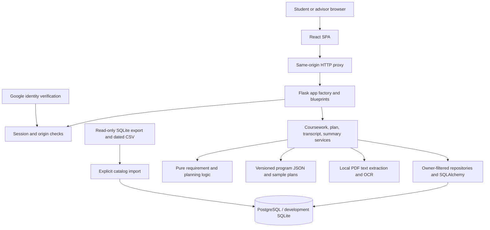
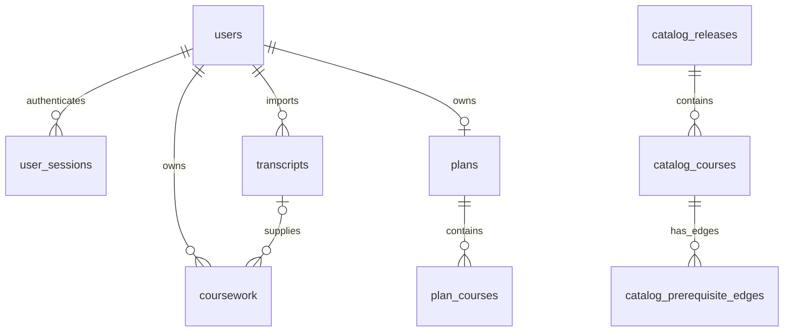

# Gopher Planner architecture

This document describes the working tree as of **2026-11-23**. It separates implemented behavior from operational limits and proposed extensions. For product workflows, see [PROJECT.md](PROJECT.md); for issue reconciliation, see [ROADMAP.md](ROADMAP.md).

## Contents

- [System shape](#system-shape)
- [Repository map](#repository-map)
- [Frontend architecture](#frontend-architecture)
- [Backend boundaries](#backend-boundaries)
- [Persistence model](#persistence-model)
- [Authentication and authorization](#authentication-and-authorization)
- [Transcript ingestion](#transcript-ingestion)
- [Requirements and metadata](#requirements-and-metadata)
- [Planning engine](#planning-engine)
- [Transactions and concurrency](#transactions-and-concurrency)
- [API surface](#api-surface)
- [Data pipelines and caching](#data-pipelines-and-caching)
- [Deployment and configuration](#deployment-and-configuration)
- [Verification strategy](#verification-strategy)
- [Operational limits](#operational-limits)
- [Extension points](#extension-points)

## System shape

Gopher Planner is a React single-page application backed by a layered Flask application. The API process handles authentication, catalog queries, coursework persistence, PDF parsing/OCR, requirement evaluation, and plan generation. It is not a set of independently deployed microservices.

User records and imported runtime catalog records share one SQLAlchemy database. Shared deployments target PostgreSQL; local development and default tests can use SQLite. Requirement definitions and sample plans remain filesystem JSON inputs. The bundled `backend/data/courses.db` is an import source, not the runtime user database or a file queried by each catalog request.



Principal boundaries:

1. The browser can suggest edits but cannot authorize ownership or certify a schedule.
2. Public catalog/program inputs are separate from private student records even when catalog tables share the same database.
3. Sample plans influence placement; versioned program rules determine requirement evaluation.
4. Slow computation is separated from persistence transactions where possible.
5. The server validates the resulting plan before accepting edits. Client checks provide earlier feedback, not the final authority.

## Repository map

```text
Gopher-Planner/
  frontend/
    src/
      app/                 Router, providers, guards, layouts
      api/                 HTTP client, endpoint functions, wire types, query keys
      features/            Auth, plan drafts, coursework, course details, loading
      screens/             Dashboard, planner, catalog, settings, onboarding, login
      hooks/               Autosave, leave warnings, media/scroll behavior
      ui/                  Shared controls, dialogs, display and skeleton primitives
      styles/              Tokens, global styles, shell layout
      test/                MSW, rendering helpers, synthetic shared fixtures
    nginx.conf             SPA routing and API reverse proxy
  backend/
    app/
      api/v1/              HTTP blueprints
      core/                Configuration, session/origin helpers, Google verification
      schemas/             Coursework and program validation
      services/            Orchestration and business logic
        planning/          Terms, prerequisites, placement, generation, validation
      repositories/        Catalog, plan persistence, per-user locking
      models/              SQLAlchemy user, session, planner, catalog entities
      parsers/             Text extraction, APAS/transcript parsing, local OCR
      extensions/          Database and migration extension setup
    migrations/            Alembic revisions
    scripts/               Export, build, validate, import commands
    data/                  Read-only export, dated snapshots, JSON seed definitions
    tests/                 Unit, API, migration and ownership tests
  compose.yaml             Local PostgreSQL, API and frontend containers
  docs/                    Product, architecture, design, roadmap and historical specs
```

Folder names describe intended responsibility, not perfect isolation. For example, profile/catalog routes still contain some validation and serialization, and services also issue SQLAlchemy queries directly. New code should improve these boundaries without pretending every request already passes through a uniform repository layer.

## Frontend architecture

### Boot and routing

[`App.tsx`](../frontend/src/app/App.tsx) installs the query provider and starts session restoration. [`router.tsx`](../frontend/src/app/router.tsx) defines public, onboarding, and authenticated routes.

- `RequireAuth` waits for session initialization and redirects unauthenticated users.
- `RequireOnboarded` loads the profile and routes incomplete accounts to onboarding.
- `AppShell` owns shared navigation, the header, global search, course details, and the plan-save bar.
- Screens coordinate data and page states; shared UI components render reusable interaction and presentation.

These guards improve navigation. Every API still authenticates independently.

### State ownership

| State | Owner | Lifetime and reason |
| --- | --- | --- |
| Profile, plan, summary, coursework, catalog responses | TanStack Query | Server state, cached by explicit query keys. |
| Session initialization and signed-in user | Zustand session store | In-memory browser session representation; backend cookie remains authoritative. |
| Onboarding choices/draft | Onboarding store | Temporary setup/navigation state, alongside persisted coursework. |
| Plan changes, extra catalog courses, selected year, generated-draft flag | Plan draft store | Edits over the saved plan; not a replacement database. |
| Selected course, graph/list view, term links, catalog search/filter state where used | URL/search parameters | Navigable and shareable screen state. |
| Open menus, input text, selection | Local component state | Component-owned interaction. |

The default query policy has a 60-second stale time, one retry, and disables refetch-on-window-focus. Mutation handlers invalidate related queries rather than assuming that profile, plan, coursework, and summary are independent.

### Plan projection and persistence

[`usePlan.ts`](../frontend/src/features/plan/usePlan.ts) composes saved courses with a minimal draft. `changes` holds altered status/term/slot/credits; `extras` supplies courses not yet in the saved plan. A draft catalog term takes precedence over the saved term.

Ordinary edits are debounced by [`useAutosave`](../frontend/src/hooks/useAutosave.ts). A generated plan sets `fromBuild`, so replacing a whole schedule waits for **Keep this plan**. The save mutation optimistically projects the sent edits into the cache. On validation failure it restores the previous saved response and merges the failed edits with newer local edits, retaining violations for review.

Plan saves refresh summary and coursework. Coursework saves/imports refresh plan and summary. Profile saves refresh relevant planning data; a major change clears the old major's draft. These dependencies prevent stale dashboard totals and requirements after an edit.

### Graph and interaction

[`GraphCanvas.tsx`](../frontend/src/screens/flow-chart/components/GraphCanvas.tsx) owns Canvas interaction; graph helpers build the model and draw it with a D3 force simulation. Layout state is a visualization concern, not plan persistence.

The semester view is the text-oriented alternative. Ordinary wheel input scrolls the page; explicit Ctrl/Command-wheel gestures zoom the graph. Course details are a non-modal drawer, so viewing a course does not lock the rest of the page. Other dialogs retain their own modal behavior.

### Loading and failure states

Shared [`Skeleton`](../frontend/src/ui/Skeleton.tsx) primitives and [`ScreenSkeletons`](../frontend/src/features/loading/ScreenSkeletons.tsx) mirror metrics, semester rows, catalog columns, form fields, and detail facts. Visual placeholders are hidden from assistive technology; a status message announces loading separately from the busy visual wrapper.

Initial loads use placeholders. Cached/background requests retain useful content where the query flow supports it. Failures produce retry states, while empty states appear after successful responses. The design must not turn missing data into a fake zero or a false empty list.

## Backend boundaries

[`create_app()`](../backend/app/__init__.py) loads settings, initializes SQLAlchemy/Migrate and CORS, installs blueprints, sets the request-size limit, and registers JSON HTTP error handling. It does not create application tables.

| Layer | Responsibilities | Examples |
| --- | --- | --- |
| Routes | HTTP parsing/status, authentication boundary, response serialization. | `api/v1/plan.py`, `profile.py`, `transcripts.py`. |
| Schemas | Validate incoming coursework and program definitions. | `schemas/coursework.py`, `schemas/programs.py`. |
| Services | Coordinate catalog/program resolution, transactions, imports and plan generation. | `services/plan.py`, `transcripts.py`, `coursework.py`. |
| Pure logic | Evaluate evidence, prerequisites, terms, placements and requirement rules. | `services/requirements.py`, `services/planning/`. |
| Repositories | Owner-filtered plan access, catalog queries, write serialization. | `repositories/plans.py`, `catalog.py`, `locks.py`. |
| Models/migrations | Persist entities and evolve their schema. | `models/`, `migrations/versions/`. |

Program and scheduling logic do not need Flask requests to run. Generation consumes materialized metadata and suggestion callbacks, making it possible to test synthetic planning problems without a live university service.

## Persistence model

### User-owned records

| Entity | Important fields and purpose |
| --- | --- |
| `users` | Stable Google subject, unique email, profile, major, standing, load preference, graduation target, onboarding/coursework flags. |
| `user_sessions` | User FK, unique hashed token, creation, expiry and revocation timestamps. |
| `transcripts` | Owner, sanitized file name, parse status/error, not-imported codes, recognized LE required/covered metadata, creation time. |
| `coursework` | Owner, code, title, credits, done/prog status, term, grade, manual/transcript source, optional transcript reference. |
| `plans` | One plan per user, explicit catalog term, generation and update timestamps. |
| `plan_courses` | One row per code within a plan, term, source and optional sample-plan slot label. |



The diagram is abbreviated: each prerequisite edge also references another catalog course. Planned codes and coursework codes are application identifiers; the schema does not require a catalog FK for every such code. That preserves imported/history records even when catalog metadata is missing.

Coursework uniqueness covers `(user_id, code, term)` plus a partial unique index for unknown/null terms. A plan is unique per user, and a planned course is unique per `(plan_id, code)`. These constraints backstop service logic.

### Public catalog records

`catalog_releases`, `catalog_courses`, and `catalog_prerequisite_edges` store the imported catalog and resolved edges. They are separate from user coursework/plan tables. Explicit import tooling writes them; ordinary planning requests do not update catalog facts.

PostgreSQL migrations enable row-level security on application tables, but that is not a substitute for route/service ownership checks. The Flask session resolves the user; this is not a frontend-direct Supabase authentication design.

## Authentication and authorization

1. Google Identity Services supplies a credential to the browser.
2. The browser sends it to `POST /api/v1/auth/google`.
3. [`verify_google_credential`](../backend/app/core/google_auth.py) verifies it using the configured audience, requires a stable subject and verified email, and checks the normalized `@umn.edu` suffix.
4. The server resolves the account by Google subject. It does not silently link unrelated identities by email.
5. It creates a cryptographically random opaque token, stores its SHA-256 hash in `user_sessions`, and returns `gp_session` as an HttpOnly, SameSite=Lax cookie. Secure behavior is configurable.
6. Future requests look up an active, unexpired, unrevoked session by token hash. Current sessions last seven days.

`JWT_SECRET` is still a required configuration value, but the implemented authentication path uses database-backed opaque sessions, not client JWT authorization. Removing the unused setting/dependency is tracked as cleanup.

State-changing routes require the exact configured frontend `Origin`; CORS permits that origin with credentials. Same-origin proxying simplifies browser cookie behavior. Frontend requests include credentials explicitly.

User-owned services filter by the session user. Transcript reads require both identity and owner. Plan repositories join through the owning plan. There is no advisor role or delegated student-record access model currently implemented; "advisor" describes a product audience, not an authorization grant.

## Transcript ingestion

The upload API is synchronous. A returned transcript ID and pollable status do not imply a background queue or worker service.

```mermaid
sequenceDiagram
    participant UI as Browser
    participant API as Transcript service
    participant DB as Database
    participant Parse as Local parser/OCR
    UI->>API: POST multipart PDF
    API->>API: Validate file and PDF signature
    API->>DB: Commit parsing metadata
    API->>DB: Materialize known catalog codes
    API->>API: Close database session
    API->>Parse: Extract text; parse APAS or generic rows
    opt Empty or suspicious extraction
        API->>Parse: Render pages and run local OCR
    end
    Parse-->>API: Normalized rows, skipped codes, audit metadata
    API->>DB: Lock user and replace imported coursework
    API->>DB: Commit terminal status
    API-->>UI: 201 with transcript ID
    UI->>API: GET transcript status and imported rows
    API-->>UI: Owner-filtered result
```

The Flask request limit is 10 MiB for the entire request. The service checks the PDF signature and sanitizes the filename. `pdfplumber` extracts text; APAS row parsing is attempted before generic transcript parsing. Known catalog codes help reject/repair narrowly recognized subject misreads. The service chooses the better parse when a local OCR pass yields more usable evidence.

OCR uses RapidOCR/ONNX locally and renders PDF pages. It bounds page count, per-page pixels, and total pixels; the model is initialized lazily per process. OCR-related logging is restricted because recognized text can otherwise leak through dependencies.

Successful imports replace previous transcript-sourced coursework for that user. Existing manual course/term attempts take precedence. Failed parsing preserves saved coursework. The stored transcript captures status, normalized import metadata, and recognized audit categories, not the raw PDF/text.

Statuses include `parsing`, `parsed`, `no_text`, and `failed`. Detailed error codes and not-imported course codes support manual correction. A long OCR pass occupies an API request and can require generous deployment timeouts; no durable retry queue is currently implemented.

## Requirements and metadata

### Program version resolution

[`programs.py`](../backend/app/services/programs.py) validates JSON files and indexes them by `(program name, catalog term)`. Missing year confirmation and unsupported year are distinct states. Unknown majors return a clear unavailable-requirements state. The program API exposes available versions and review state without silently choosing a year.

Only official program ID `019627107` is marked reviewed. Program loaders cache validated definitions per directory and return data for the selected version. The complete schema and evidence policies are specified in [program-requirements-v2.md](specs/program-requirements-v2.md).

### Requirement evaluation

[`requirements.py`](../backend/app/services/requirements.py) evaluates rule trees using completed and projected evidence. Rules can express specific courses, alternatives, grouped requirements, set-based counts/credits, and review conditions. Grade policy, attempt selection, and explicitly sourced sharing declarations affect which evidence qualifies.

Allocation is deterministic and greedy. Specific rules claim evidence before broader alternatives where the evaluation policy requires it. Reuse across groups is allowed only through the corresponding sharing declaration. Unresolved conditions remain `needs_review` rather than becoming fabricated passes or failures.

### Course metadata

[`metadata.py`](../backend/app/services/metadata.py) resolves course records from program supplements and catalog rows, keeping source/review/conflict information. Structured prerequisite expressions are separate from display text. Known metadata conflict or unavailable metadata may block automatic placement; unverified text is surfaced for review rather than guessed into a structured prerequisite.

The UI's flat prerequisite list is for display. Both backend and client scheduling checks retain the tree so an OR requirement is not mistaken for an AND.

### Credit summary

[`summary.py`](../backend/app/services/summary.py) calculates earned credit and GPA using Decimal arithmetic and the repository's grade mapping. In-progress/planned work is not earned credit. The degree total comes from the resolved program, with a 120-credit fallback when no program is available. That fallback is an application display behavior, not a claim that every degree requires 120 credits.

Requirement progress and credit progress remain different outputs. Reaching a total does not prove all specific rules are met.

## Planning engine

### Inputs and outputs

Generation receives a resolved program, coursework, normalized course metadata, an ordered term window, credit preference, and optional sample-plan/LE inputs. The engine returns placements, warnings, suggested-course metadata, and remaining free elective credits.

Plans use Fall and Spring. Summer coursework can be recorded and ordered as prior evidence, but summer plan generation is not supported. Current-term selection uses the application calendar helper; it is not a live university academic-calendar service. The default future window is eight terms, bounded at twelve for a supplied target.

### Generation stages

1. Resolve the user's explicit program version and capture the planning snapshot.
2. Materialize coursework, catalog metadata, sample-plan codes, and LE suggestion alternatives.
3. Include the current term if there is no in-progress coursework.
4. Release the input transaction before running the engine.
5. Seed sample-plan placements mapped to the graduation target, or anchored to the first planning term when the target is missing.
6. Skip satisfied work and locked completed/in-progress courses. Carry sample-slot labels into suggestions.
7. Fill unmet machine-checkable requirements, inserting prerequisite closure where metadata supports it.
8. Apply ordering, offering-season, and credit-capacity checks. Try alternate branches when a candidate branch cannot be placed.
9. Build the wire response with requirement progress, slot labels, warnings, and `electiveCredits`.
10. Return a dry-run preview, or reacquire the user lock, revalidate the snapshot, and persist atomically.

Candidate ranking prefers program recommendations, useful requirement coverage where applicable, the program's home subject, lower added prerequisite cost, lower level, and deterministic code/source ordering. Alternative branches consider existing evidence, explicit preference, and additional credits. Read [`generate.py`](../backend/app/services/planning/generate.py) for the exact context-specific ranking functions.

This is a bounded greedy search with a step limit, not a global solver or proof of infeasibility. Persisting a generated result is a separate orchestration step; the pure engine does not write a database.

### Liberal education and elective handling

Catalog designations and recognized APAS required/covered status inform which sample-plan LE slots remain open. The service preloads prerequisite-free, season-compatible alternatives so the engine callback does not query the database. Choices favor coverage of missing categories and exclude existing evidence/suggestions.

Selected courses retain a `slot` label. The API also exposes derived category coverage for swap suggestions. An LE filter can intersect multiple requested designations. A slot label describes the purpose of the suggestion; it does not certify every theme/writing policy described by the broader LE roadmap.

`electiveCredits` reports the gap to the selected total after projected credits. Arbitrary courses are not inserted just to consume that balance.

## Transactions and concurrency

### Ordinary saves

Plan and coursework replacement are read-modify-write operations. [`lock_user`](../backend/app/repositories/locks.py) serializes writes on the owning user row in PostgreSQL using a row lock that permits necessary foreign-key checks. SQLite has no equivalent row locks and serializes writers through its own database locking.

Plan saves validate the request and the resulting schedule, then persist only the owner's changes and commit. A scheduling conflict returns `409` with machine-readable violations. An invalid resulting state must not partially update enrollment or planned courses.

Changing a course between current and future terms crosses persistence domains: current enrollment is coursework; future placement is a plan row. The service handles that transition transactionally. Grade/history attempts must not be silently overwritten by a move.

### Generated plans

The generation snapshot includes major, graduation target, credit load, coursework, saved planned courses/slots, and saved catalog term. For a persisted generation, the service locks and refreshes the user after computation and compares fresh state with the snapshot. If it changed, it returns `409 plan_changed` and asks for another build rather than overwriting newer work.

Dry runs do not replace planned rows or persist the selected catalog term. Their `jobId` identifies the response but is not a durable generation-job record. There is no plan-version history or general version-token protocol for ordinary saves.

### Major changes

Profile updates acquire the owning user lock. A changed major clears the saved plan's catalog-term confirmation. Coursework and planned courses remain stored. On the client, successful profile changes invalidate planning data and clear the old major's temporary draft.

## API surface

The base prefix is `/api/v1`, except `/health`. Catalog/program endpoints are also authenticated. Consult route files for complete validation and response details.

| Method and path | Purpose | Source |
| --- | --- | --- |
| `GET /health` | Process health response; not a database/readiness guarantee. | `app/__init__.py` |
| `POST /auth/google` | Verify Google credential and issue a session cookie. | `api/v1/auth.py` |
| `GET /auth/session` | Restore the current authenticated user. | `api/v1/auth.py` |
| `POST /auth/logout` | Revoke the current session and clear its cookie. | `api/v1/auth.py` |
| `GET`, `PUT /profile` | Read/update the authenticated profile. | `api/v1/profile.py` |
| `GET /summary` | GPA and earned-credit summary. | `api/v1/summary.py` |
| `GET`, `PUT /coursework` | Read/replace normalized coursework. | `api/v1/coursework.py` |
| `POST /transcripts` | Multipart PDF import. | `api/v1/transcripts.py` |
| `GET /transcripts/<id>` | Owner-filtered status and imported-course result. | `api/v1/transcripts.py` |
| `GET /programs` | Supported program/version summaries and review state. | `api/v1/plan.py` |
| `GET`, `PUT /plan` | Read the assembled plan or validate/persist edits. | `api/v1/plan.py` |
| `POST /plans/generate` | Generate a preview or persisted plan. | `api/v1/plan.py` |
| `GET /courses` | Search/filter/paginate catalog records, including LE filtering. | `api/v1/courses.py` |
| `GET /courses/<code>` | Catalog details and resolved prerequisite references. | `api/v1/courses.py` |

Wire types live in [`frontend/src/api/types.ts`](../frontend/src/api/types.ts). Plan responses include `terms`, `currentTerm`, `baseCredits`, courses, selected/available catalog terms, requirement progress, warnings, and elective-credit balance. Course display state can be completed, in progress, planned, available, or blocked; only the appropriate subsets are persisted.

Common error responses carry `error` and sometimes `code` and `violations`. The shared frontend client maps status/body data into `ApiError`. Error handling is not completely uniform across all older routes. JSON HTTP handlers cover framework errors, but this should not be read as an OpenAPI contract or generated API schema.

## Data pipelines and caching

| Input | Transformation | Runtime use |
| --- | --- | --- |
| `data/courses.db` plus full course CSV | `scripts/import_catalog.py` / `services/catalog_import.py` | Imported catalog tables; source file stays read-only. |
| Dated program exports and reviewed overlays | Program build/validation scripts | Versioned `data/programs/<id>--<term>.json`. |
| Public sample-plan exports | `export_sample_plans.py`, `build_sample_plans.py` | `data/sample_plans/<program-id>.json`. |
| Student PDF | Local parsing/OCR and normalized import | Private coursework and transcript metadata. |

Reviewed source rows take precedence over broader CSV metadata where the importer defines that policy. Catalog imports replace seed tables in a transaction. They are explicit maintenance commands, not per-request scrapers or automatic semester refreshes.

Program definitions use a process-local validated dictionary cache; sample plans use an LRU cache keyed by directory and program ID. OCR initializes its engine lazily per process. These caches are not distributed or coordinated across workers. After deploying changed definitions, restart relevant processes or use the available explicit cache-clearing path in controlled tooling/tests. A browser query invalidation does not invalidate server-side definition caches.

There is no Redis, background scheduler, sections snapshot service, or automatic external-data refresh pipeline. The [data guide](../backend/data/README.md) documents exact snapshots, rebuild commands, provenance, and unmatched sample-plan pages.

## Deployment and configuration

### Local processes

The Vite development server normally uses port 5173 and proxies `/api` to Flask on 5000. Flask can use the development SQLite fallback or an explicitly configured local PostgreSQL instance. Migrations and catalog import run separately before relying on data-backed features.

### Compose topology

`compose.yaml` defines:

- PostgreSQL 17, bound to local port 5432, with persistent storage and a database healthcheck.
- API container, bound to local port 5000, using the Compose database URL.
- Frontend/nginx container, bound to local port 3000, with SPA fallback routing and `/api/` proxying to the API service.

The frontend image compiles Vite variables at build time. Editing a runtime container environment does not change the already built frontend client ID. nginx's SPA fallback supports direct navigation to application routes.

### Configuration precedence

The backend reads existing process variables first, then `backend/.env`, then root `.env`. Required settings and accepted database schemes are implemented in [`core/config.py`](../backend/app/core/config.py). Frontend Vite variables are configured separately; all are public bundle input.

Use one exact `FRONTEND_ORIGIN` matching the browser origin. Set secure cookies for HTTPS. If a separate API origin is introduced, review browser cookie, CORS, origin-protection, proxy, and TLS behavior together rather than changing only an API URL.

### Schema lifecycle

SQLAlchemy models describe persistence; Alembic revisions are the schema-change mechanism. The app factory does not call `create_all` or run migrations. The current container entrypoint does run `flask db upgrade` before starting Flask; this is an operational exception to address, not an architectural recommendation for application startup.

Do not infer the deployed Supabase revision from the repository head. Apply migrations only through an authorized deployment procedure and verify the target revision separately.

## Verification strategy

| Layer | Current approach |
| --- | --- |
| Parsing | Synthetic APAS/transcript text and generated PDFs; local OCR behavior tested without real student records. |
| Requirements/engine | Small invented program/catalog fixtures, branch ranking, evidence, prerequisites, terms, coverage and elective balance. |
| API | Flask test client, session/origin/ownership checks, atomic save failures, read-only dry runs. |
| Persistence | Migrated temporary SQLite by default; disposable PostgreSQL for database-specific locking/RLS behavior. |
| Frontend | Vitest, Testing Library and MSW for delayed requests, error states, saves, edits and query invalidation. |
| Loading/accessibility | Deferred-response tests plus desktop/mobile browser checks with synthetic API data. |
| Build | TypeScript project checks and Vite production build. |

`TEST_DATABASE_URL` is destructive by design: fixtures drop and recreate its public schema. Never use a shared/Supabase database. Backend fixtures set a synthetic application database URL before constructing the app.

The `frontend/e2e/` directory currently documents an intended Playwright suite but does not itself establish a configured end-to-end test runner. CI runs backend tests on SQLite and PostgreSQL, migration checks, frontend tests and builds on every pull request; CD gates deploys on the same checks (see the README). Commands and contribution expectations are in [CONTRIBUTING.md](../CONTRIBUTING.md).

## Operational limits

The current architecture has these explicit limits:

- The container starts Flask's development server; no production WSGI serving strategy is configured here.
- OCR and generation are synchronous. There is no durable job queue, cancellation/retry protocol, or workload isolation.
- `/health` is a process response; Compose does not define an API readiness healthcheck.
- Definition caches and OCR instances are process-local and need memory/reload consideration when adding workers.
- There is no complete rate-limiting, expired-session cleanup, audit-event, metrics, alerting, or backup/restore subsystem documented by the implementation.
- A real deployment's access controls, TLS, logs, retention and backups require separate configuration and verification.
- Catalog and requirement accuracy varies by source/review state; plans do not certify graduation or exact-term availability.
- The generator and evaluator are deterministic greedy systems, not globally optimal solvers.
- Summer planning, concurrent-enrollment enforcement, advisor delegation, plan history, and live registration are not implemented.

These limits should remain visible when describing hosting or supported behavior. See [#12](https://github.com/Troppy2/Gopher-Planner/issues/12), [SECURITY.md](../SECURITY.md), and [ROADMAP.md](ROADMAP.md).

## Extension points

1. **More reliable academic coverage:** add sourced program versions/overlays and structured metadata through existing validation pipelines. Preserve explicit unverified/review states.
2. **Full LE tracker:** extend versioned rule/evidence models and audit parsing with verified policies before treating category suggestions as full certification.
3. **External sections/instructors/grades:** add permitted-source adapters, explicit import/snapshot tables and provenance. Keep scheduled catalog changes separate from student edits and avoid fetching on page views.
4. **Background workloads:** if OCR/generation latency or concurrency warrants a queue, introduce durable job state, ownership, cancellation/retry behavior and independent worker transactions rather than holding request sessions open.
5. **Production operations:** introduce explicit migrations, a supported serving process, real CI/CD, readiness, rate limits, monitoring and recovery procedures.
6. **Registration handoff:** use supported copy/deep-link/import interfaces only after confirming permission and technical support. Do not collect student university credentials.

These are design directions tied to open issues, not claims that the corresponding infrastructure already exists. Keep dependencies and acceptance criteria in the [roadmap](ROADMAP.md) and issue discussions.
